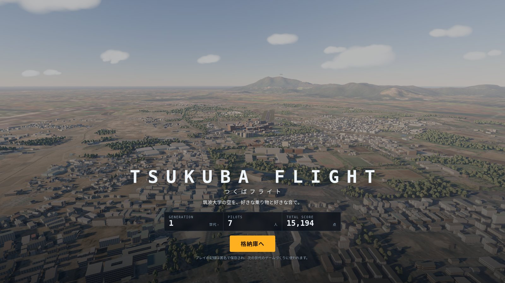
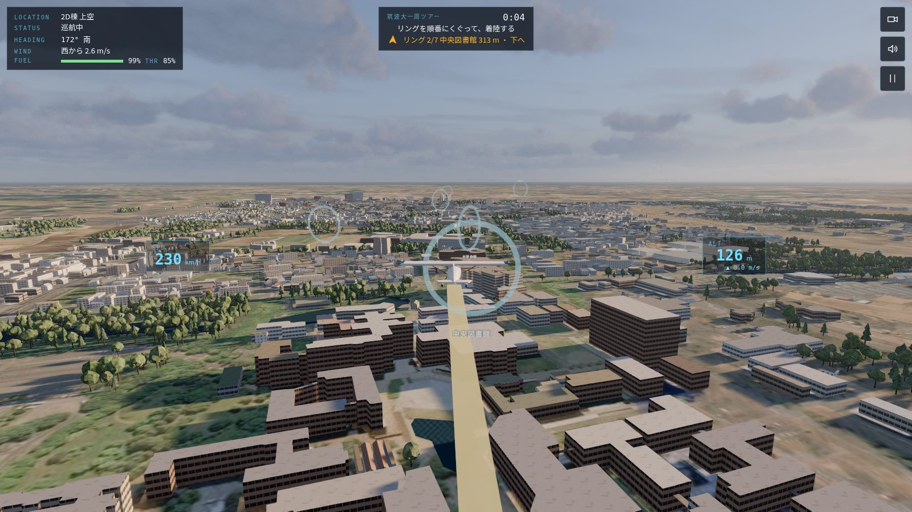
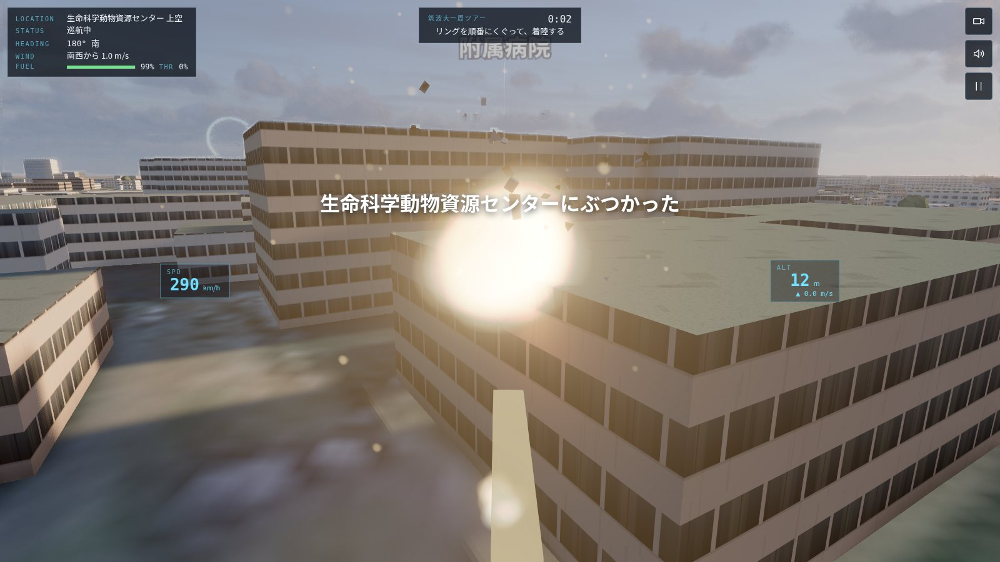
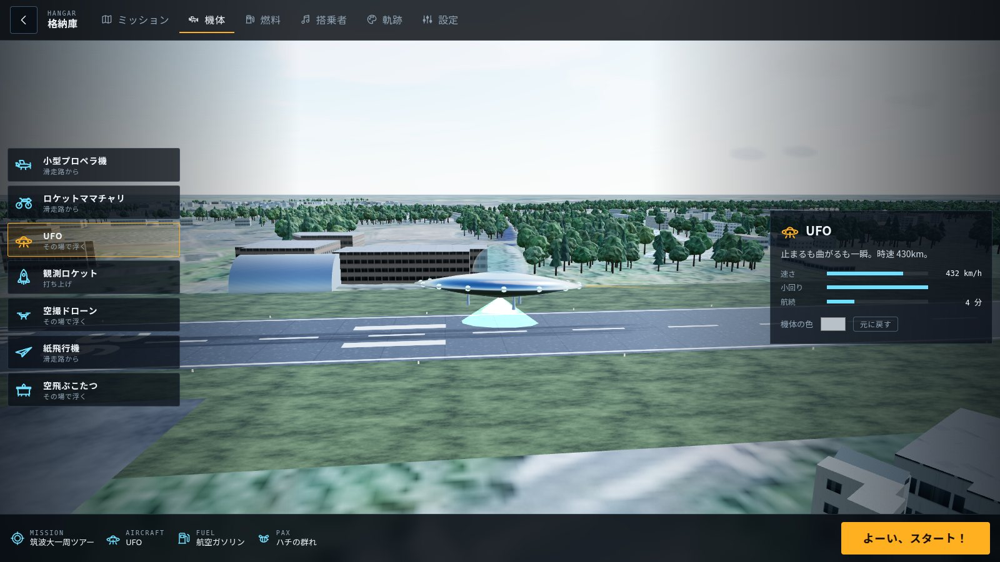
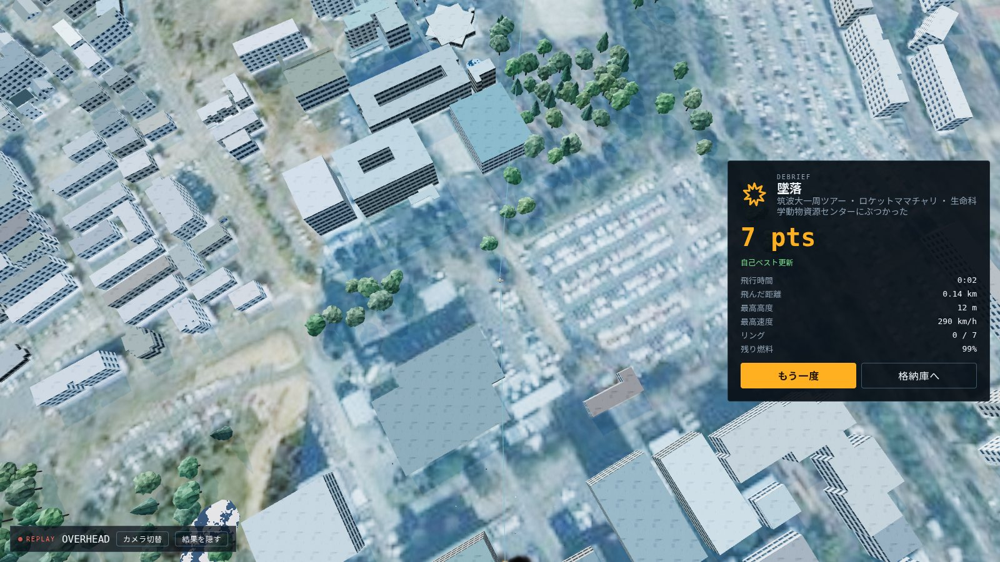
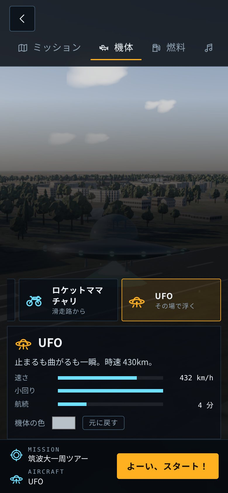
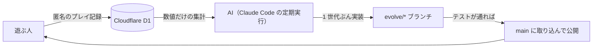

<div align="center">

# TSUKUBA FLIGHT ／ つくばフライト

**筑波大学の空を、好きな乗り物と好きな音で。遊ばれるほど変わっていくフライトゲーム。**



WebGL（three.js） ・ パソコンとスマホ ・ インストール不要 ・ 筑波大学非公式

</div>

---

## どんなゲーム？

実際の地形・航空写真・約 8,600 棟の建物でつくった筑波大学のまわりを飛ぶゲームです。
小型プロペラ機から UFO まで、好きな機体に好きな燃料を積み、ハチやクラリネットを乗せて飛び立ちます。
乗せた搭乗者の音楽は、速さ・上昇・旋回に合わせてその場で変わります。

そしてこのゲームは**遊ばれるほど変わります。** 定期的に AI がみんなのプレイ記録（数値だけ）を読み、新しい乗り物や音、景色を足して次の世代へ進めます。

<table>
<tr>
<td width="50%"><br><sub>現在地・状態・方位・風、次のリングへの矢印を出す計器</sub></td>
<td width="50%"><br><sub>建物・森・地面にぶつかると墜落。燃料が切れたら操縦不能で落ちる</sub></td>
</tr>
<tr>
<td width="50%"><br><sub>格納庫。選んだ機体が目の前を旋回し、色や軌跡の変更がすぐ見える</sub></td>
<td width="50%"><br><sub>終わると、飛んだ道すじとリプレイ。墜落の瞬間はスローで</sub></td>
</tr>
</table>

## ミッション

| ミッション | 目的 |
| --- | --- |
| **筑波大一周ツアー** | 一の矢から春日まで、名所に浮かぶ 7 つのリングを順にくぐって着陸する |
| **風船割り** | 4 分以内に、キャンパスの上に浮かぶ赤い風船をできるだけ多く割る |

## 機体

| 機体 | 最高速度 | ひとこと |
| --- | ---: | --- |
| 小型プロペラ機 | 252 km/h | 素直で扱いやすい。滑走路から飛ぶ |
| ロケットママチャリ | 378 km/h | 荷台にロケット、段ボールの翼 |
| UFO | 432 km/h | 止まるも曲がるも一瞬 |
| 観測ロケット | 576 km/h | 真上に打ち上がる。燃費は最悪 |
| 空撮ドローン | 90 km/h | 小回りの王様 |
| 紙飛行機 | 115 km/h | 巨大な紙飛行機。ふわふわ |
| 空飛ぶこたつ | 108 km/h | みかん付き |

燃料は航空ガソリン・学食の天ぷら油・はちみつ・納豆・研究室のコーヒー・炭酸。パワーと持ちが変わります。
搭乗者はハチの群れ・シンセ・クラリネット・ラッパ・ねこ・カエル・鐘・風鈴。自分で音色とメロディをつくることもできます。

## 操作



| 操作 | パソコン | スマホ |
| --- | --- | --- |
| 操縦 | ↑ ↓ ← → | 画面の左側をドラッグ |
| スロットル | W ／ S | 右のバー |
| カメラ | C | 右上のボタン |
| 一時停止 | P ／ Esc | 右上のボタン |

「よーい、スタート！」のあとは、何もしなくても飛び立ちます。ゲームパッドにも対応しています。

<br clear="right">

## 遊ばれるほど変わる仕組み



- AI は手順書 [docs/EVOLUTION.md](docs/EVOLUTION.md) に沿って、乗り物・音・景色・ミッション・調整などから 1 つを選んで実装します
- プレイ記録は**数値と既知の ID だけ**で渡します。プレイヤーが入力した文字列は AI に渡らないので、AI を操る書き込み（プロンプトインジェクション）は届きません
- テストは「壊れたら遊べない」ことだけを確かめます。通らなければ公開されません
- タイトル画面の「GENERATION」を押すと、これまでの進化の記録が見られます

## 技術

| | |
| --- | --- |
| 描画 | three.js（WebGL）。PBR マテリアル、太陽の影、空の映り込み、大気の霞 |
| 画面 | 素の HTML と CSS、TypeScript。アイコンは自作の SVG |
| 音 | Web Audio でその場で合成（音声ファイルなし） |
| 物理 | 機体ごとの簡単な飛行モデル（three.js に依存しない TypeScript） |
| サーバー | Cloudflare Workers ＋ D1 |
| ビルドとテスト | Vite、Vitest、Playwright |
| 地図 | 国土地理院の標高タイル（遊ぶたびに読み込む）と航空写真、OpenStreetMap の建物・森・水辺 |

```
src/content/   乗り物・燃料・搭乗者・ミッション・景色のデータ（ここを足すとゲームが増える）
src/sim/       物理・当たり判定・ゲームの進行（テスト対象）
src/world/     地形・建物・木・景色の 3D と、標高の読み込み
src/render/    機体・軌跡・爆発・リプレイ
src/audio/     音の合成
src/ui/        格納庫とアイコン
worker/        Cloudflare Worker（配信とプレイ記録 API）
scripts/       地図データの作成、進化ループの補助
```

## 手元で動かす

```sh
npm ci
npm run local      # ビルドして http://localhost:8787 で起動（プレイ記録はローカルの D1 に保存）
npm test           # 型チェック・ユニットテスト・ビルド
npm run test:e2e   # ブラウザでの通しテスト
```

描画の重さは格納庫の「設定」で低・中・高から選べます（最初はスマホが中、パソコンが高）。

| | 高 | 中 | 低 |
| --- | --- | --- | --- |
| 空と光 | 物理ベースの大気・空気遠近 | 物理ベースの大気・空気遠近 | 簡単な空と霧 |
| 雲 | 立体の雲 | 板の雲 | 板の雲（少なめ） |
| 影 | 遠くまで（カスケード） | 自機のまわり | なし |
| 接地の暗さ（AO） | あり | なし | なし |
| 木 | 多い・影あり | ふつう | 少ない |

## 集めるデータ

ゲームを良くしていくために、遊んだ記録を**数値だけ**集めています。

- 選んだもの：ミッション・機体・燃料・搭乗者・軌跡の色と形・機体の色・描画の重さ
- 結果：飛行時間・距離・最高高度・最高速度・リングと風船の数・得点・終わり方
- 飛び方（0.5 秒ごと）：位置・向き・スロットル・速さ・操作
- 搭乗者の音楽（0.5 秒ごと）：テンポ・勢い・リズムの細かさ・移調・逆再生かどうか
- 出来事の時刻：離陸・リング通過・風船・接地・カメラ切り替え・一時停止

ブラウザごとのランダムな ID で記録し、名前やメールアドレスなどの個人情報は集めません。AI に渡す集計も数値と既知の ID だけです。

## 出典

- 標高：[国土地理院](https://maps.gsi.go.jp/development/ichiran.html)の標高タイル。リポジトリには含めず、遊ぶたびに国土地理院から読み込み、ゲームの中で地形に加工しています
- 航空写真：[国土地理院](https://maps.gsi.go.jp/development/ichiran.html)の地理院タイル（全国最新写真（シームレス））を加工して作成（撮影時期の違う写真の継ぎ目と色をならしています）
- 建物・森・水域・建物の名前：© [OpenStreetMap](https://www.openstreetmap.org/copyright) contributors
- 立体の雲（描画「高」）：[three-geospatial](https://github.com/takram-design-engineering/three-geospatial)（MIT）の雲のテクスチャ（`public/clouds/`）。ブルーノイズのテクスチャは遊ぶときに同プロジェクトから読み込みます
- 滑走路と発射台は架空のものです

このゲームは筑波大学とは関係のない、非公式のファンゲームです。

## ライセンス

- コード：[MIT](LICENSE)
- `public/data/world.json` のうち建物・森・水域・名前（OpenStreetMap 由来）：[Open Database License (ODbL) 1.0](https://opendatacommons.org/licenses/odbl/1-0/)
- `public/data/near.jpg`・`far.jpg`：[国土地理院コンテンツ利用規約](https://www.gsi.go.jp/kikakuchousei/kikakuchousei40182.html)に従う
