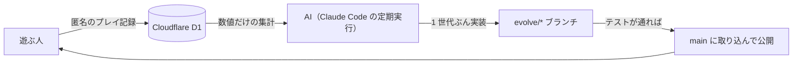

<div align="center">

# TSUKUBA FLIGHT ／ つくばフライト

**筑波大学の空を、好きな乗り物と好きな音で。遊ばれるほど変わっていくフライトゲーム。**


**[▶ ブラウザで遊ぶ](https://tsukuba-flight.akkunlab.workers.dev)**

WebGL（three.js） ・ パソコンとスマホ ・ インストール不要 ・ 筑波大学非公式

</div>

---

## どんなゲーム？

実際の地形・航空写真・約 8,600 棟の建物でつくった筑波大学のまわりを飛ぶゲームです。
小型プロペラ機から UFO まで、好きな機体に好きな燃料を積み、ハチやクラリネットを乗せて飛び立ちます。
乗せた搭乗者の音楽は、速さ・上昇・旋回に合わせてその場で変わります。

そしてこのゲームは**遊ばれるほど変わります。** 定期的に AI がみんなのプレイ記録（数値だけ）を読み、新しい乗り物や音、景色を足して次の世代へ進めます。

<table>
<tr>
<td width="50%"><br><sub>現在地・状態・方位・風、次のリングへの矢印を出す計器</sub></td>
<td width="50%"><br><sub>建物・森・地面にぶつかると墜落。燃料が切れたら操縦不能で落ちる</sub></td>
</tr>
<tr>
<td width="50%"><br><sub>格納庫。選んだ機体が目の前を旋回し、色や軌跡の変更がすぐ見える</sub></td>
<td width="50%"><br><sub>終わると、飛んだ道すじとリプレイ。墜落の瞬間はスローで</sub></td>
</tr>
</table>

## ミッション

| ミッション | 目的 |
| --- | --- |
| **筑波大一周ツアー** | 一の矢から春日まで、名所に浮かぶ 7 つのリングを順にくぐって着陸する |
| **風船割り** | 4 分以内に、キャンパスの上に浮かぶ赤い風船をできるだけ多く割る |

## 機体

| 機体 | 最高速度 | ひとこと |
| --- | ---: | --- |
| 小型プロペラ機 | 252 km/h | 素直で扱いやすい。滑走路から飛ぶ |
| ロケットママチャリ | 378 km/h | 荷台にロケット、段ボールの翼 |
| UFO | 432 km/h | 止まるも曲がるも一瞬 |
| 観測ロケット | 576 km/h | 真上に打ち上がる。燃費は最悪 |
| 空撮ドローン | 90 km/h | 小回りの王様 |
| 紙飛行機 | 115 km/h | 巨大な紙飛行機。ふわふわ |
| 空飛ぶこたつ | 108 km/h | みかん付き |

燃料は航空ガソリン・学食の天ぷら油・はちみつ・納豆・研究室のコーヒー・炭酸。パワーと持ちが変わります。
搭乗者はハチの群れ・シンセ・クラリネット・ラッパ・ねこ・カエル・鐘・風鈴。自分で音色とメロディをつくることもできます。

## 操作


| 操作 | パソコン | スマホ |
| --- | --- | --- |
| 操縦 | ↑ ↓ ← → | 画面の左側をドラッグ |
| スロットル | W ／ S | 右のバー |
| カメラ | C | 右上のボタン |
| 一時停止 | P ／ Esc | 右上のボタン |

「よーい、スタート！」のあとは、何もしなくても飛び立ちます。ゲームパッドにも対応しています。

<br clear="right">

## 遊ばれるほど変わる仕組み



AI は 6 時間ごとに [docs/EVOLUTION.md](docs/EVOLUTION.md) に沿って 1 つ変更を加えます。AI に渡すのは数値の集計だけで、プレイヤーが入力した文字は渡しません。

## 技術

three.js（WebGL）・TypeScript・Web Audio・Cloudflare Workers ＋ D1・Vite・Vitest・Playwright

```sh
npm ci
npm run local      # http://localhost:8787 で起動
npm test           # 型チェック・ユニットテスト・ビルド
npm run test:e2e   # ブラウザでの通しテスト
```

## 集めるデータ

ゲームの改善のため、選んだ機体などの設定・飛び方・結果を数値で記録します。ブラウザごとのランダムな ID で記録し、個人情報は集めません。

## 出典・ライセンス

- コード：[MIT](LICENSE)
- 標高・航空写真：[国土地理院](https://maps.gsi.go.jp/development/ichiran.html)のタイルを加工して作成（[利用規約](https://www.gsi.go.jp/kikakuchousei/kikakuchousei40182.html)）
- 建物・森・水域：© [OpenStreetMap](https://www.openstreetmap.org/copyright) contributors（[ODbL](https://opendatacommons.org/licenses/odbl/1-0/)）
- 雲のテクスチャ：[three-geospatial](https://github.com/takram-design-engineering/three-geospatial)（MIT）

筑波大学とは関係のない非公式のファンゲームです。滑走路と発射台は架空のものです。
